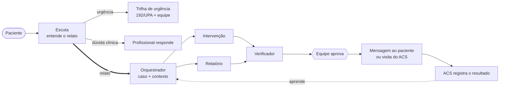

# Pulse

**Uma solução agêntica de acompanhamento da atenção primária à saúde, que descobre por que o paciente parou o tratamento e coloca a ação certa nas mãos da equipe.**

Metade dos pacientes com doenças crônicas não segue o tratamento como prescrito (OMS, 2003). Quase sempre o motivo não é clínico: a pessoa não consegue ler a receita, se perde entre seis remédios, mora sozinha ou acha que já está boa. A equipe de Saúde da Família costuma descobrir isso tarde.

Com o Pulse, o paciente conta a dificuldade do jeito dele, por texto ou voz. Os agentes entendem o relato, identificam a barreira, buscam contexto com fonte e preparam uma intervenção. A equipe aprova com um clique e o agente comunitário de saúde (ACS) fecha o ciclo em campo. **Nenhuma ação chega ao paciente sem aprovação humana.**

> Protótipo com dados 100% fictícios. Não substitui avaliação clínica.

---

## Como funciona



1. **O paciente fala.** A Escuta separa o que é urgência, o que é dúvida clínica e o que é uma dificuldade com o tratamento.
2. **Urgência e dúvida clínica não ficam com a IA.** A urgência recebe 192/UPA na hora e gera um alerta que sobe do plantão ao gestor. A dúvida clínica vai para um profissional, com prazo.
3. **A dificuldade vira caso.** O orquestrador abre o caso, busca trechos de bulas, protocolos e histórico do paciente e escolhe o especialista.
4. **O especialista propõe, o verificador confere.** A proposta só chega à equipe sem conduta clínica, com fonte e dentro do catálogo da unidade.
5. **A equipe decide e o ACS fecha o ciclo.** O resultado encerra o caso, abre uma nova rodada ou leva à busca ativa, e a taxa de sucesso de cada intervenção é atualizada.

## Os agentes

| Agente | O que faz | O que nunca faz |
|---|---|---|
| **Escuta** | Conversa com o paciente, detecta urgência e dúvida clínica e classifica a barreira em um catálogo fechado | Escrever texto livre, ver outros pacientes ou agir sobre o cuidado |
| **Orquestrador** | Abre ou retoma o caso, guarda o estado, recupera o contexto e delega ao especialista certo | Delegar fora do que a regra permite para aquele tipo de entrada |
| **Intervenção** | Escolhe, por chamada de ferramenta, uma ação do catálogo entre as que as regras liberaram | Executar a ação, propor item fora da lista ou citar fonte que não recebeu |
| **Relatório** | Redige o relatório do paciente a partir do registro do ACS, com a fonte de cada frase | Manter frase sem fonte: o código descarta |
| **Verificador** | Confere a proposta com regras e com um segundo modelo independente. Se reprova, o especialista refaz uma vez | Deixar passar dose, horário, troca ou interrupção de medicamento |

Os agentes usam `openai/gpt-oss-120b` via Groq, com saída estruturada estrita e prompts versionados em [backend/app/prompts/](backend/app/prompts/). A descrição completa de cada etapa (entrada, lógica e saída) está em [docs/fluxo-do-produto.md](docs/fluxo-do-produto.md).

## Por que dá para confiar

- **Regra antes do modelo.** Urgência, aceite, risco, prazos e limites são decididos em código. Se uma regra de urgência dispara, o modelo nem é consultado.
- **Fronteira entre quem conversa e quem age.** A Escuta e o Cuidado não se importam no código. Só quatro objetos tipados atravessam, por [fronteira.py](backend/app/fronteira.py).
- **Texto do paciente é dado, nunca instrução.** Ele entra nos prompts isolado em blocos delimitados. Tentativas de manipulação são marcadas no rastro e não mudam o comportamento.
- **O modelo não inventa valores.** Barreira, especialista, item do catálogo e fonte são listas fechadas no esquema, e toda resposta é validada de novo pelo Pydantic.
- **Toda afirmação tem fonte.** O contexto vem de um corpus fechado de bulas e protocolos e do histórico, buscado com BM25 ([rag.py](backend/app/cuidado/rag.py)).
- **Humano no controle.** Toda ação passa pela equipe. Antes de executar, o sistema confere de novo o aceite, o estado do paciente e a validade. Cada ação roda uma única vez, garantido por uma chave única no banco.
- **Falha vira caminho humano.** Recusa, erro de rede ou resposta fora do esquema nunca chegam ao paciente: o caso vai para a equipe.
- **Privacidade por padrão.** Sem aceite, nenhuma mensagem sai, exceto a de emergência. A conversa expira em 7 dias, e o gestor só vê números agregados, sem nomes.

## Veja funcionando em 10 minutos

```sh
git clone https://github.com/Mangue-Bit/pulse-ai.git
cd pulse-ai
cp .env.example .env      # Windows: copy .env.example .env
python iniciar.py
```

Requer Python 3.11+ e Node.js 20+. Sem chave de API, o Pulse roda com um modelo simulado e determinístico, e o fluxo inteiro funciona. Para usar o modelo real, preencha `GROQ_API_KEY` no `.env`.

Abra a interface (em geral `http://localhost:5173`) e entre em **Demonstração guiada**:

| Faça | Repare em |
|---|---|
| Envie o roteiro **Dificuldade com o remédio** | O paciente recebe resposta na hora, só com texto aprovado. Uma proposta de áudio explicando a receita aparece para a equipe |
| Abra **Por que o Pulse sugeriu isso** e aprove | A justificativa, as fontes e a verificação. Depois de aprovada, a mensagem chega ao paciente em áudio |
| **Recomeçar** e envie **Sinal de urgência** | Orientação de 192/UPA imediata, alerta à equipe e fila do paciente suspensa |
| Envie **Dúvida sobre dose** ou **Tentativa de manipulação** | O agente não responde. A pergunta vai para um profissional |
| Abra **Tablet da ACS** e registre o resultado | O caso é encerrado e a taxa de sucesso da intervenção é atualizada |
| Abra **Rastro das decisões** | Cada etapa com quem decidiu (regra, modelo, pessoa ou ferramenta), o prompt, o modelo e a latência |
| Use **Avançar o relógio** com um alerta aberto | O alerta sobe de nível até virar pendência crítica |

Para ver outros caminhos, troque de paciente: Francisco nunca deu aceite, João revogou o aceite, Luzia está internada e Raimunda está em busca ativa.

## Rastro e métricas

Cada etapa do fluxo grava um evento com identificador estável (`E03`, `C18`, `I02`...). O evento registra quem decidiu, o que entrou e o que saiu, além do modelo, da versão do prompt, da latência, dos tokens e do custo. É por esse rastro que se investiga qualquer resposta ruim.

Em `/api/metricas` e na aba **Indicadores** do rastro:

- **Aprovação sem edição:** taxa de propostas aprovadas sem mudança pela equipe.
- **Reprovação do verificador:** taxa de propostas barradas pelo verificador.
- **Urgência:** falsos positivos e dúvidas que venceram o prazo.
- **Operação:** latência e custo, por caso e por versão de prompt.

## Onde estamos

**Pronto:** Escuta, trilha de urgência, orquestrador, especialistas de Intervenção e Relatório, verificador, aprovação, execução por ferramentas, desfecho com rodadas e atualização do catálogo. A interface cobre a demonstração guiada, a equipe, o tablet do ACS, o rastro e a visão do gestor. São 169 testes automatizados, rodados no CI.

**Próximos passos:** especialista de Território (priorização por microárea), modelo de risco de abandono treinado, avaliação offline com casos rotulados e canal WhatsApp.

## Para desenvolver

| | |
|---|---|
| **Stack** | FastAPI, Pydantic, SQLModel e SQLite · Groq (`gpt-oss-120b`) · BM25 · React, TypeScript, Vite, Tailwind e shadcn/ui |
| **Configuração** | `GROQ_API_KEY`, `PULSE_MODELO`, `PULSE_MODELO_VERIFICADOR`, `PULSE_BANCO` e `PULSE_MODELO_SIMULADO`, descritas em [.env.example](.env.example) |
| **Testes** | `.venv/bin/python -m pytest -q backend` · `npm --prefix frontend run build` · `npm --prefix frontend run lint` |
| **API** | Documentação interativa em `http://localhost:8000/docs` |
| **Código** | [backend/app/escuta/](backend/app/escuta/) · [backend/app/cuidado/](backend/app/cuidado/) · [backend/app/regras/](backend/app/regras/) · [frontend/src/areas/](frontend/src/areas/) |
| **Arquitetura** | [Fluxo do produto](docs/fluxo-do-produto.md) · [Guia de implementação](docs/guia-de-implementacao.md) |

Branches `feat/`, `fix/`, `docs/` ou `chore/` com Conventional Commits, integradas em `develop` e promovidas para `main`. Nunca versione chaves, `.env`, bancos ou dados reais de pacientes.
